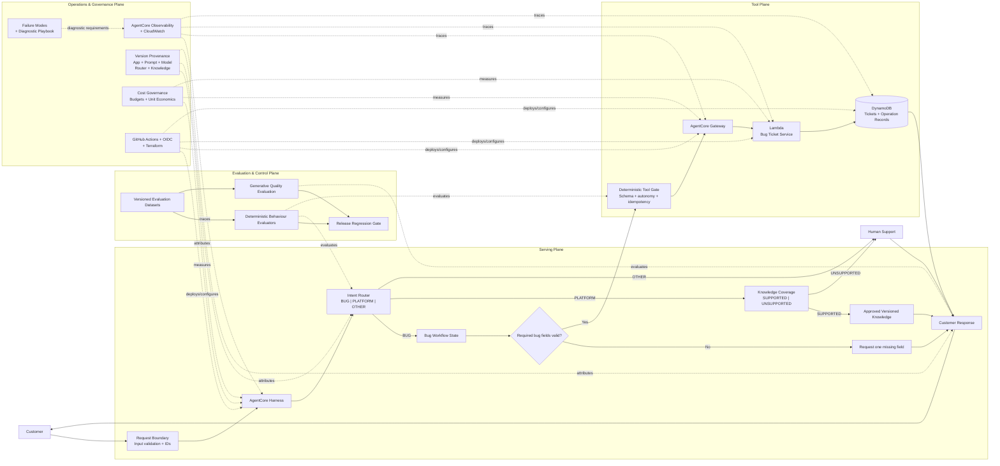

# Reliora Logical Architecture

## Purpose

This document defines the logical architecture for Reliora before implementation-specific deployment details are finalized.

The diagram focuses on:

- system responsibilities;
- workflow boundaries;
- deterministic control points;
- side-effect boundaries;
- human escalation;
- evaluation;
- observability;
- operational governance.

It intentionally distinguishes logical architecture from the final AWS deployment architecture.

---

# Architecture Principle

> **The LLM may propose; deterministic software validates and authorizes.**

Reliora treats generative model output as probabilistic input to controlled software workflows rather than as unrestricted authority.

---

# Logical Architecture

---

# Architecture Planes

Reliora is organized conceptually into four planes.

## 1. Serving Plane

The serving plane handles customer interaction and decision flow.

Responsibilities include:

- request validation;
- identifier creation;
- agent execution;
- intent routing;
- conversational bug-information collection;
- knowledge coverage;
- grounded response generation;
- human escalation.

The serving plane should not independently authorize unsafe side effects.

---

## 2. Tool Plane

The tool plane contains operations that interact with backend business state.

The initial Reliora side-effecting workflow is bug-ticket creation.

The path is:

`Validated workflow state`

→ `Deterministic tool gate`

→ `AgentCore Gateway`

→ `Lambda`

→ `DynamoDB`

The deterministic tool gate is a critical control boundary.

It verifies that a proposed action is allowed before execution.

---

## 3. Evaluation and Control Plane

The evaluation plane determines whether Reliora behaves according to its documented contracts.

It separates:

### Deterministic behavioural evaluation

Used for exact properties such as:

- whether a tool executed;
- whether required fields were complete;
- whether duplicate tickets were created;
- whether prohibited internal information leaked;
- whether schemas were valid.

### Generative-quality evaluation

Used for properties requiring judgement such as:

- helpfulness;
- clarity;
- semantic completeness;
- response quality.

Both contribute evidence, but critical deterministic failures can block release regardless of aggregate generative-quality score.

---

## 4. Operations and Governance Plane

This plane supports safe operation and controlled change.

Responsibilities include:

- observability;
- diagnostics;
- deployment provenance;
- infrastructure management;
- release management;
- cost governance;
- failure analysis;
- operational evidence.

It is not part of the customer's conversational reasoning path, but it determines whether engineers can safely operate and change the system.

---

# Primary Request Paths

## Bug Report

A bug-report workflow follows:

`Customer`

→ request validation

→ AgentCore Harness

→ intent = `BUG`

→ bug workflow state

→ required-field validation

→ deterministic tool authorization

→ AgentCore Gateway

→ Lambda

→ DynamoDB

→ validated backend result

→ customer response.

If required information is incomplete, the tool path must not execute.

Reliora instead asks for the next required missing field.

---

## Supported Platform Question

A platform-information workflow follows:

`Customer`

→ request validation

→ AgentCore Harness

→ intent = `PLATFORM`

→ knowledge coverage = `SUPPORTED`

→ approved versioned knowledge

→ grounded response.

---

## Unsupported Platform Question

An unsupported platform request follows:

`Customer`

→ intent = `PLATFORM`

→ knowledge coverage = `UNSUPPORTED`

→ structured human handoff.

The model must not manufacture unsupported policy information.

---

## Other Request

Requests outside the supported automated workflows follow:

`Customer`

→ intent = `OTHER`

→ structured human handoff.

---

# Critical Control Boundaries

## CB-001 — Input Boundary

Customer input is untrusted.

Input size, structure, and other application-level constraints must be applied before unsafe downstream use.

---

## CB-002 — Model Output Boundary

Model output is probabilistic.

Machine-consumed model output must pass a defined schema or typed contract.

---

## CB-003 — Tool Authorization Boundary

A model proposing a tool call does not authorize execution.

The deterministic tool gate evaluates whether the proposed operation is allowed.

---

## CB-004 — Side-Effect Boundary

The Lambda/DynamoDB path changes persistent business state.

Operations crossing this boundary require:

- validated arguments;
- stable operation identity;
- idempotency;
- backend confirmation;
- traceability.

---

## CB-005 — Human Handoff Boundary

Reliora transfers control to a human when automation is:

- unsupported;
- ambiguous;
- unsafe;
- repeatedly unsuccessful;
- unable to establish an authoritative side-effect outcome.

---

# Identifier Propagation

Reliora distinguishes three identifiers.

## request_id

Represents one individual request.

Used for tracing a single processing path.

## session_id

Represents the broader customer conversation.

Used when multiple customer turns belong to one interaction.

## operation_id

Represents one logical side-effecting business action.

It must remain stable across retries of the same logical operation.

Conceptually:

`session_id`

→ many `request_id` values

→ one side-effect may use one stable `operation_id`.

---

# Failure Boundaries

The architecture deliberately exposes important failure boundaries instead of assuming managed services eliminate failure.

Potential boundaries include:

`Customer`

→ request validation failure

→ model/agent failure

→ routing failure

→ knowledge-coverage failure

→ tool authorization failure

→ Gateway failure

→ Lambda failure

→ DynamoDB failure

→ response-path failure.

These boundaries map to the Reliora failure-mode analysis and diagnostic playbook.

---

# Retry Boundary

Retry behaviour must be coordinated across layers.

A failure must not cause uncontrolled retry amplification such as:

`Agent retry`

→ `Gateway retry`

→ `Lambda retry`

→ persistence retry

→ increasing downstream load.

Retry ownership, limits, backoff, timeouts, and idempotency will therefore be explicitly defined during implementation.

---

# Observability Boundary

Operational telemetry should allow engineers to reconstruct important execution facts without storing hidden model reasoning.

Useful provenance includes:

- request ID;
- session ID where applicable;
- operation ID where applicable;
- route;
- application version;
- prompt version;
- model/configuration version;
- routing version;
- knowledge version;
- tool proposal;
- authorization result;
- backend result;
- latency;
- error category.

---

# Deployment Boundary

The logical architecture does not yet assert the complete physical AWS deployment topology.

Current likely AWS capabilities include:

- Amazon Bedrock;
- Amazon Bedrock AgentCore Harness;
- AgentCore Gateway;
- AWS Lambda;
- Amazon DynamoDB;
- AgentCore Observability;
- Amazon CloudWatch;
- AWS IAM;
- AWS Budgets and cost-management capabilities.

Persistent infrastructure is intended to be managed through Terraform.

CI/CD is intended to use GitHub Actions with AWS OIDC rather than long-lived AWS credentials.

These remain subject to the relevant ADRs and implementation verification.

---

# What Is Deliberately Absent

The initial architecture does not include:

- Kubernetes or Amazon EKS;
- Kafka or Amazon MSK;
- Redis;
- multi-agent orchestration;
- persistent customer memory;
- browser automation;
- code interpretation;
- mandatory vector-database RAG;
- multi-region deployment;
- elaborate frontend infrastructure.

These capabilities require a documented requirement or measured justification before entering the architecture.

---

# Relationship to Failure Analysis

The architecture and failure model must remain synchronized.

For example:

`AgentCore Gateway`

exists in the architecture

→ therefore Gateway failure exists in the failure model

→ therefore telemetry must allow Gateway failure detection

→ therefore the diagnostic playbook must explain how to investigate it

→ therefore fault testing should eventually verify the expected response.

Architecture boxes that cannot be operated or diagnosed should be treated as incomplete production design.

---

# Architecture Status

**Status: PROPOSED LOGICAL ARCHITECTURE**

This diagram represents the intended P1-S2 design before complete implementation.

It must be revised if implementation evidence or accepted ADRs materially change the architecture.

The final portfolio deployment diagram will represent the system that was actually deployed rather than merely the system originally proposed.