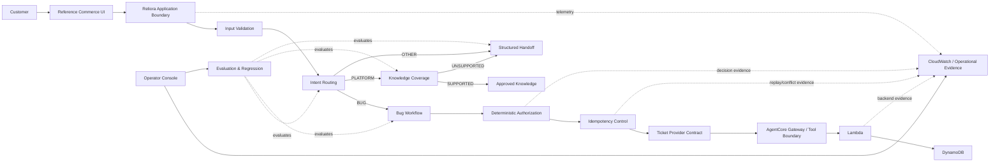

# Reliora Product Constitution and Production Delivery Standard

**Document type:** Governing product and execution document
**Product:** Reliora
**Portfolio project:** P1-S2
**Status:** Living source of truth
**Version:** 1.1
**Established:** 2026-09-03
**Current implementation and evidence status:** [Handover current state](../handover/CURRENT_STATE.md)
**Current delivery branch:** `chore/reliora-handover-readiness` (verify actual Git state)
**Status metadata refreshed:** 2026-09-22; governing scope and decision rules unchanged

---

# 0. Purpose and Authority

This document defines how Reliora is to be designed, built, deployed, demonstrated, evaluated, documented, and presented from this point forward.

Reliora is not to be treated as:

- a classroom chatbot;
- a collection of AWS screenshots;
- a technology showcase with no product identity;
- a synthetic "enterprise" system that claims scale it has not measured;
- a feature dump designed to maximize the number of services listed on a résumé.

Reliora is to be treated as a **commercially credible product reference implementation**: the kind of focused system an engineering consultancy, AI product studio, or internal platform team could build for a growing online retailer and then adapt for a real deployment.

The governing idea is:

> **Reliora should look, behave, deploy, and be explained like a product a serious company could pilot—not like a completed tutorial.**

This document complements, rather than replaces:

1. the official Udacity/AWS P1 specification;
2. [RELIORA-PRODUCT-NORTH-STAR.md](../../RELIORA-PRODUCT-NORTH-STAR.md);
3. Reliora functional requirements;
4. Reliora non-functional requirements;
5. autonomy and human-intervention policy;
6. logical architecture;
7. ADRs;
8. evaluation contracts;
9. evidence artifacts.

If a conflict occurs, the official project specification remains authoritative for mandatory submission requirements. Reliora may strengthen those requirements, but it must not silently remove or replace them.

## 0.1 Context Isolation and Source Precedence

Reliora inherits the **Portfolio Product Engineering Standard** only for shared engineering-quality practices. That inheritance must never be used to import another portfolio product's capabilities, architecture, AWS services, model choices, workflows, or scope into Reliora.

When making a Reliora decision, use the following precedence order:

1. official Udacity/AWS P1 requirements and rubric;
2. this Reliora Product Constitution;
3. [RELIORA-PRODUCT-NORTH-STAR.md](../../RELIORA-PRODUCT-NORTH-STAR.md);
4. Reliora-specific requirements, ADRs, policies, architecture, evaluation contracts, and preserved evidence;
5. the Portfolio Product Engineering Standard;
6. general engineering knowledge and external documentation.

A more specific Reliora rule overrides a broader portfolio rule.

Examples:

- The portfolio standard may permit RAG where justified, but Reliora currently prefers a small approved versioned knowledge source and explicitly excludes mandatory RAG unless evidence creates a new requirement.
- The portfolio standard may recognize multi-agent systems as valid architecture, but Reliora is not a multi-agent product unless a future Reliora-specific requirement and ADR justify that change.
- Browser automation, persistent personalized memory, Code Interpreter, and other capabilities used by different portfolio products must not be inferred as Reliora requirements.
- A technology appearing in another project does not become a Reliora dependency merely because all projects share a common engineering standard.

The governing isolation rule is:

> **Shared standards define how well Reliora is engineered; Reliora-specific sources define what Reliora is.**

Cross-project knowledge may be used as comparative design context, but it must be labelled as comparison or inspiration rather than treated as a Reliora requirement.

---

# 1. Product Identity

## 1.1 Product name

**Reliora**

## 1.2 Product category

**AI Customer-Support Reliability and Control Platform for Online Commerce**

Reliora is not simply a chatbot.

The conversational support experience is one interface into a wider reliability and control product.

## 1.3 Product thesis

Online retailers increasingly want AI-assisted customer support, but putting a language model between customers and business systems creates operational risk.

The difficult part is not generating fluent responses.

The difficult part is determining whether the business can trust the system to:

- route requests correctly;
- stay grounded in approved policy;
- gather required information;
- authorize actions safely;
- avoid duplicate side effects;
- confirm backend truth;
- escalate cleanly;
- explain what happened operationally;
- detect regressions;
- control latency and cost.

Reliora exists to solve that problem.

## 1.4 Governing product statement

> **Reliora enables online retailers to automate appropriate customer-support interactions while placing deterministic reliability, safety, observability, evaluation, and cost controls around probabilistic AI behaviour.**

## 1.5 Core engineering principle

> **The LLM may propose; deterministic software validates and authorizes.**

This principle must remain visible throughout:

- architecture;
- code;
- tests;
- UI;
- operations;
- portfolio explanation.

---

# 2. Product Standard

Reliora should be developed as though a client has contracted an engineering team to deliver a production-oriented customer-support product.

The implementation should therefore answer:

1. What problem is the client paying us to solve?
2. Who uses the product?
3. What does the user experience?
4. What does an operator experience?
5. What can go wrong?
6. How does the system prevent or contain failure?
7. How is the system deployed?
8. How is it configured for another retailer?
9. How is its behaviour evaluated before release?
10. How is cost measured?
11. How is a failure diagnosed?
12. How can infrastructure be destroyed and reproduced?
13. What evidence supports every important portfolio claim?

The product standard is:

> **Focused scope + polished experience + strong controls + measurable evidence + reproducible delivery.**

Maximum feature count is not a quality metric.

---

# 3. Target Market and Buyer

## 3.1 Primary target customer

Small-to-mid-size and growing online retailers that want AI-assisted support without treating an LLM as an uncontrolled business-action engine.

Reference markets may include:

- United States;
- United Kingdom;
- Canada;
- South Africa;
- other comparable digital-commerce markets.

The implementation must not imply that Reliora currently has real commercial customers.

## 3.2 Economic buyer

Potential buyers include:

- Head of Customer Support;
- Customer Experience leader;
- CTO;
- VP Engineering;
- Head of AI / Automation;
- E-commerce Operations leader;
- Platform Engineering leader.

## 3.3 Technical evaluator

Potential technical evaluators include:

- Solutions Architects;
- AI/ML Engineers;
- Platform Engineers;
- Cloud Engineers;
- DevOps Engineers;
- Security Engineers;
- Data/ML Platform teams.

## 3.4 End user

The primary end user is the retailer's customer seeking support.

Secondary users are:

- support agents;
- support managers;
- reliability engineers;
- engineering teams;
- AI platform operators.

---

## 3.5 Problem-Buyer Evidence Gate

Reliora must not continue major product expansion merely because engineering work already exists or because an industry problem is plausible.

Before a major product investment, the current evidence must be reviewed across:

- problem credibility;
- customer workflow evidence;
- buyer/economic-owner evidence;
- incumbent alternatives;
- measurable value potential;
- security, reliability, privacy, and operational risk;
- implementation and operating burden;
- technical feasibility.

The gate must end in exactly one of the following product decisions.

### CONTINUE

Use `CONTINUE` when:

- the problem remains credible for the intended customer;
- the proposed buyer or economic owner plausibly owns the pain;
- existing alternatives do not already remove the material problem sufficiently;
- the intended value can be measured;
- the required architecture and operating burden are proportionate;
- current evidence does not reveal a stronger reason to narrow, pivot, stop, or defer.

`CONTINUE` does not convert hypotheses into validated customer evidence.

### NARROW

Use `NARROW` when:

- the problem is credible but evidence supports only part of the proposed scope;
- buyer or workflow evidence is weaker than the breadth of planned investment;
- additional automation would increase risk or complexity faster than demonstrated value;
- a smaller workflow can test the thesis more directly.

A `NARROW` decision authorizes only the bounded scope explicitly identified by the gate.

### PIVOT

Use `PIVOT` when:

- the strongest evidence points to a materially different customer problem;
- a different buyer or operational owner is more plausible;
- the strongest value appears to be in reliability/control tooling rather than the current customer-facing workflow;
- evidence shows that the current framing is not the best expression of the validated need.

A pivot requires a new or amended product decision. Existing engineering must not be used as a reason to preserve a disproven framing.

### STOP

Use `STOP` when:

- the problem is not material;
- existing alternatives solve it sufficiently;
- credible customer or buyer evidence contradicts the thesis;
- operating cost, implementation burden, or risk is disproportionate to plausible value;
- AI provides no meaningful advantage over a simpler solution for the intended problem.

Stopping a direction is an acceptable product outcome.

### DEFER

Use `DEFER` when:

- available evidence is insufficient for a responsible decision;
- the missing evidence can be obtained without building substantial new product capability;
- the next useful action is research, discovery, measurement, or a bounded experiment rather than feature implementation.

`DEFER` is not permission to accumulate speculative architecture.

### Evidence guardrails

The following boundaries always apply:

- industry evidence may establish that a problem class exists, but not that a specific Reliora customer has that problem;
- synthetic customers, costs, traffic, workflows, and ROI remain synthetic;
- local engineering evidence does not prove market demand or production outcomes;
- existing engineering investment does not justify continued scope by itself;
- missing buyer evidence must not be compensated for by adding technology;
- customer or production claims must remain narrower than the evidence that supports them.

### Reassessment triggers

Re-run the gate when material new evidence changes any of:

- target customer;
- economic buyer;
- supported workflow;
- autonomy level;
- side-effect scope;
- operating model;
- primary value proposition;
- incumbent alternative;
- risk profile;
- deployment burden;
- measured unit economics.

The gate is a product-governance control, not a one-time documentation exercise.

---

# 4. Jobs To Be Done

Reliora should help a retailer accomplish the following jobs.

## JTBD-001 — Automate eligible support

When a customer asks a supported question, the business wants a correct, grounded response without unnecessary human intervention.

## JTBD-002 — Collect useful bug reports

When a customer reports a product problem, the business wants sufficient structured detail for engineering follow-up without forcing the customer through a rigid form.

## JTBD-003 — Execute side effects safely

When AI proposes a persistent action, the business wants deterministic controls before that action changes business state.

## JTBD-004 — Survive retries

When requests are retried because of network or dependency failures, the business wants one logical action—not duplicate records.

## JTBD-005 — Escalate intelligently

When automation is unsupported, uncertain, unsafe, or unsuccessful, the customer should move to a human workflow without losing useful context.

## JTBD-006 — Diagnose failures

When something goes wrong, engineers should be able to reconstruct the request path without reading hidden chain-of-thought.

## JTBD-007 — Prevent regressions

When models, prompts, routing logic, policies, or application code change, the business should detect known behavioural regressions before promotion.

## JTBD-008 — Control AI economics

The business should understand what the support automation costs at a workload level and where expensive model inference is unnecessary.

---

# 5. Value Proposition

Reliora's commercial value should be framed around outcomes rather than AWS services.

The product aims to provide:

- safer AI-assisted support;
- fewer duplicate side effects;
- more reliable ticket creation;
- clearer human escalation;
- grounded platform-policy answers;
- observable request paths;
- measurable routing quality;
- regression protection;
- controlled operating cost;
- easier adaptation to an existing support stack.

Potential future business-value measurements include:

- eligible automation rate;
- handoff rate;
- successful eligible resolution rate;
- duplicate-ticket rate;
- support ticket completeness;
- average latency;
- cost per request;
- cost per successful eligible resolution;
- regression escape rate;
- mean time to diagnose;
- support-agent rework.

Business ROI must remain a synthetic model until supported by real customer data.

---

# 6. Product Boundary

## 6.1 What Reliora is

Reliora is:

- a support reliability and control layer;
- a reference customer-support experience;
- a controlled AI application runtime;
- an evaluation and release-safety system;
- an observable operational product;
- an adaptable reference implementation.

## 6.2 What Reliora is not

Reliora is not:

- Shopify;
- a full order-management system;
- a real payment processor;
- a warehouse-management platform;
- a CRM replacement;
- a billing platform;
- a multi-tenant SaaS billing system;
- a generalized enterprise agent platform;
- a mandatory RAG product;
- a multi-agent system;
- a Kubernetes showcase.

The reference storefront exists to demonstrate the customer problem and experience.

It must not become the project.

---

# 7. Product Experience

Reliora should eventually have two polished product surfaces.

## 7.1 Customer-facing reference commerce application

The customer experience should look like a credible modern online retailer.

Its purpose is to make the support journey understandable in context.

The storefront should eventually support enough interaction to demonstrate:

- product browsing;
- product detail;
- a lightweight cart;
- checkout simulation;
- order/support context where relevant;
- embedded customer support.

It does not need:

- real payment processing;
- real inventory;
- real warehouse operations;
- complete authentication;
- complete commerce functionality.

### Example scenario

A customer:

1. opens a product;
2. adds it to a cart;
3. proceeds to checkout;
4. experiences a simulated checkout failure;
5. opens Reliora support;
6. reports the problem;
7. is guided through bug-detail collection;
8. receives a confirmed ticket ID;
9. retries the request;
10. does not create a duplicate ticket.

The UI makes the business problem visible.

The backend proves the engineering solution.

## 7.2 Reliora operator console

The internal console should demonstrate why a business would pay for the reliability layer.

Potential surfaces:

### Overview

- support request count;
- route distribution;
- automated outcomes;
- human handoffs;
- ticket operations;
- failure count/rate;
- latency indicators;
- cost indicators.

### Request Explorer

- request ID;
- session ID;
- operation ID where relevant;
- route;
- workflow state;
- authorization result;
- idempotency state;
- backend outcome;
- deployment/configuration version;
- latency;
- failure category.

### Evaluation

- deterministic regression status;
- generative evaluation status;
- routing benchmark summary;
- known failure cases;
- release-gate result.

### Operations

- recent failures;
- dependency failures;
- alerts;
- diagnostic references;
- deployment version;
- environment status.

Only justified surfaces should be implemented.

A beautiful empty dashboard is less valuable than a smaller dashboard backed by real evidence.

---

# 8. Frontend and AWS Decoupling

The frontend must not require permanent AWS resources merely to exist.

This is a deliberate product architecture rule.

The product should support multiple runtime modes.

## 8.1 Local Product Demo Mode

Purpose:

- UI development;
- recruiter walkthroughs;
- offline demonstrations;
- zero-cloud-cost development after AWS teardown.

Possible structure:

```text
Reference Storefront
        ↓
Reliora UI/API client
        ↓
Local application service
        ↓
Reference/mock adapters
```

The local mode must preserve the same domain contracts as the cloud implementation where practical.

It must be visibly labelled as a local/demo environment when shown as evidence.

It must not pretend that mocked state came from AWS.

## 8.2 AWS Integration Mode

Purpose:

- real cloud verification;
- submission evidence;
- production-architecture validation;
- operational measurements;
- cloud demonstrations.

Conceptually:

```text
Reference Storefront
        ↓
Reliora application/API boundary
        ↓
AgentCore / application runtime
        ↓
Gateway
        ↓
Lambda
        ↓
DynamoDB
```

with supporting:

- CloudWatch;
- evaluation;
- IAM;
- cost monitoring;
- version provenance.

## 8.3 Ephemeral Portfolio Cloud Mode

When a live full-stack demonstration is required:

1. deploy infrastructure;
2. run verification;
3. point the UI at the cloud environment;
4. demonstrate;
5. capture evidence;
6. destroy resources.

The product should not require an always-on cloud environment merely to remain presentable in the portfolio.

## 8.4 Permanent Hosted Demo

This is optional.

It may be considered only when:

- cost is justified;
- access is controlled;
- abuse prevention exists;
- operational ownership is understood;
- a live demo materially improves hiring outcomes.

---

# 9. Core Functional Workflows

Reliora preserves the official P1 functional baseline and strengthens its controls.

## 9.1 BUG workflow

Expected path:

```text
Customer request
    ↓
input validation
    ↓
intent = BUG
    ↓
incremental bug-field collection
    ↓
description
steps_to_reproduce
environment
    ↓
deterministic authorization
    ↓
idempotency admission
    ↓
approved ticket provider
    ↓
authoritative backend confirmation
    ↓
persist/replay result
    ↓
customer receives confirmed ticket ID
```

Critical requirements:

- no premature ticket creation;
- no fabricated ticket ID;
- retry safety;
- conflicting operation identity must not silently mutate;
- unconfirmed side-effect outcomes must not become guessed success.

## 9.2 Supported PLATFORM workflow

```text
Customer request
    ↓
intent = PLATFORM
    ↓
coverage = SUPPORTED
    ↓
approved versioned knowledge
    ↓
grounded response
```

The approved small knowledge source remains appropriate unless scale or retrieval requirements justify RAG.

## 9.3 Unsupported PLATFORM workflow

```text
intent = PLATFORM
    ↓
coverage = UNSUPPORTED
    ↓
structured human handoff
```

The system must not manufacture policy.

## 9.4 OTHER workflow

Unsupported automated workflows should transition to structured human support.

## 9.5 Explicit human request

A customer who explicitly requests a person should not be trapped behind automation.

---

# 10. Product Capability Map

Reliora capabilities are grouped into four planes.

## 10.1 Serving Plane

Responsibilities:

- input validation;
- identity propagation;
- conversational support;
- intent routing;
- bug-state collection;
- knowledge coverage;
- grounded response;
- escalation.

## 10.2 Tool / Side-Effect Plane

Responsibilities:

- deterministic tool authorization;
- logical operation identity;
- idempotency;
- backend adapters;
- authoritative confirmation;
- safe retry/replay.

## 10.3 Evaluation and Control Plane

Responsibilities:

- deterministic behavioural evaluation;
- generative-quality evaluation;
- routing experiments;
- regression gates;
- evidence retention.

## 10.4 Operations and Governance Plane

Responsibilities:

- logging;
- tracing;
- metrics;
- alerts;
- deployment provenance;
- cost;
- security controls;
- release controls;
- teardown;
- diagnostics.

---

# 11. Architecture Principles

## APROD-001 — Product first

Technology must serve a documented product requirement.

## APROD-002 — AWS-first, not AWS-defined

AWS is the primary implementation environment because of the current program and certification path.

Reliora's product identity must not depend on AWS service names.

## APROD-003 — Probabilistic reasoning, deterministic control

LLMs may classify, extract, summarize, and propose.

Deterministic software owns authorization and persistent business-state rules.

## APROD-004 — Interfaces before vendors

Provider contracts and adapters should isolate business logic from external systems where doing so produces real adoptability.

## APROD-005 — Build less, prove more

A narrower feature set with strong evidence is preferred over broad incomplete architecture.

## APROD-006 — Evidence before claim

No reliability, performance, cost, scale, or ROI claim should exceed available evidence.

## APROD-007 — Reproduce before optimize

Deployment, testing, and teardown should be reproducible before introducing optimization complexity.

## APROD-008 — Failure is part of the product

The system must demonstrate controlled failure behaviour, not just happy paths.

## APROD-009 — Cost is architecture

Cloud and AI cost are design constraints, not post-project accounting.

## APROD-010 — Portability is selective

Abstractions should protect meaningful product boundaries.

Do not create generic abstraction layers merely to claim multi-cloud portability.

---

# 12. Target Technical Architecture



This is conceptual.

Final implementation details remain governed by requirements and ADRs.

---

# 13. Engineering Baseline

Reliora should use a recognizable, production-relevant engineering toolchain where each tool has a purpose.

## 13.1 Backend language

**Python 3.12**

## 13.2 Dependency and environment management

**uv**

## 13.3 Domain validation

**Pydantic**

## 13.4 Unit and integration testing

**pytest**

## 13.5 Static typing

**mypy**

## 13.6 Linting and formatting

**Ruff**

## 13.7 Containerization

**Docker**

Target uses:

- local product demo environment;
- application packaging;
- CI parity;
- future deployable service boundary where relevant.

Docker must not be added merely to display a Dockerfile.

Preferred later local experience:

```text
docker compose up
```

to start an appropriate subset of:

- reference storefront;
- local Reliora application boundary;
- reference adapters;
- development dependencies.

The AWS architecture does not need to be rewritten around ECS/EKS merely because Docker exists.

## 13.8 Infrastructure as Code

**Terraform**

Responsibilities:

- reproducibility;
- reviewability;
- environment configuration;
- teardown;
- infrastructure provenance.

## 13.9 CI/CD

**GitHub Actions**

Target responsibilities:

- dependency installation;
- Ruff;
- mypy;
- pytest;
- deterministic evaluation;
- security scans;
- Terraform formatting/validation;
- deployment workflow where justified.

AWS authentication should use short-lived identity such as GitHub OIDC rather than committed long-lived credentials.

## 13.10 Security scanning

Preferred baseline:

- **Gitleaks** for secret scanning;
- **Checkov** for Terraform/IaC scanning.

## 13.11 Observability

Primary AWS-first baseline:

- Amazon CloudWatch;
- AgentCore-native operational evidence where available.

OpenTelemetry or a third-party observability product may be added later only when a clear integration or portability need exists.

## 13.12 Frontend

Preferred product-experience baseline:

- **Next.js**;
- **React**;
- **TypeScript**;
- **Tailwind CSS** or a similarly maintainable utility/design-system approach.

Do not allow frontend framework work to delay cloud-dependent core evidence before the current AWS deadline.

## 13.13 End-to-end UI testing

Preferred later baseline:

- **Playwright**

---

# 14. Tool Selection Rule

No technology enters Reliora simply because it is popular.

Before adding a tool, ask:

1. What requirement does it satisfy?
2. What risk does it reduce?
3. What measurable limitation does it solve?
4. What operational burden does it introduce?
5. Is there a simpler existing tool that already solves the problem?
6. Does the tool improve the product or merely the résumé keyword count?

A mainstream tool is valuable when it is used credibly.

A tool is not valuable merely because it appears in the repository.

---

# 15. AWS Implementation Standard

The current AWS implementation must preserve the official P1 architecture requirements while strengthening them through Reliora controls.

Current core AWS services include:

- Amazon Bedrock;
- Amazon Bedrock AgentCore managed harness;
- Amazon Bedrock AgentCore Gateway;
- AWS Lambda;
- Amazon DynamoDB;
- Amazon CloudWatch;
- Amazon S3 where required for evaluation artifacts;
- Bedrock Evaluations;
- IAM.

Current region:

**`us-east-1`**

Current baseline model required by the official P1 project:

**Amazon Nova Pro**

Reliora should preserve this baseline for submission compatibility.

Alternative-model benchmarking may be added separately as an experiment and must not silently invalidate the required baseline.

---

# 16. Cloud Portability Strategy

Reliora is AWS-first.

It is not "multi-cloud" merely because interfaces exist.

Portability should be created around meaningful boundaries.

Good candidates:

- `TicketProvider`;
- knowledge provider;
- telemetry provider;
- handoff provider;
- model/router provider where justified;
- configuration.

Bad portability:

- wrappers around every AWS call for no reason;
- abstracting stable infrastructure without a real second implementation;
- designing for three clouds before one product works.

Future versions could demonstrate selected substitutions using Azure or Google Cloud.

That should be treated as a deliberate architecture evolution, not a requirement for P1-S2.

---

# 17. Off-the-Shelf Adaptation Boundary

A retailer should conceptually be able to adopt Reliora through:

```text
configure
    ↓
connect adapters
    ↓
deploy
    ↓
verify
    ↓
pilot
```

not:

```text
fork
    ↓
rewrite everything
```

Potential configuration includes:

- retailer name;
- branding;
- support contact;
- escalation queue;
- approved knowledge;
- supported workflows;
- backend ticket adapter;
- deployment environment;
- AWS region where supported;
- log retention;
- redaction policy;
- model configuration;
- routing version;
- UI branding.

At minimum, product architecture should demonstrate a clean replacement point for the ticket backend.

Potential later adapters include:

- Zendesk;
- Jira Service Management;
- ServiceNow;
- Salesforce Service Cloud;
- custom retailer support API.

Reliora does not need all of them.

---

# 18. Identity and Correlation Model

Reliora distinguishes:

## request_id

One individual processing request.

## session_id

One broader support conversation.

## operation_id

One logical side-effecting business action.

Example:

```text
Request 1:
request_id = R1
session_id = S1
operation_id = O1

Retry:
request_id = R2
session_id = S1
operation_id = O1
```

The difference is central to reliable side effects.

---

# 19. Side-Effect Safety Standard

The minimum side-effect chain is:

```text
proposal
    ↓
typed validation
    ↓
authorization
    ↓
idempotency admission
    ↓
approved provider
    ↓
authoritative backend confirmation
    ↓
result persistence
    ↓
customer-visible success
```

The application must distinguish:

- proposed;
- authorized;
- executed;
- confirmed;
- replayed;
- conflicted;
- unconfirmed.

A generic `success = true` should not replace meaningful state.

---

# 20. Idempotency Standard

Reliora must support at least:

## New logical operation

```text
O1 + P1
→ NEW_OPERATION
```

## Matching retry

```text
O1 + P1
→ MATCHING_OPERATION
→ existing authoritative result
→ REPLAYED
```

## Conflict

```text
O1 + P2
→ CONFLICT
→ no execution
```

A conflict must not overwrite original operation state.

A matching retry after successful execution must not call the provider again.

---

# 21. Backend Truth Standard

The model must never fabricate:

- execution success;
- ticket identifiers;
- backend confirmation.

Customer-facing ticket success requires authoritative backend confirmation.

If the system cannot establish whether a side effect succeeded:

```text
UNCONFIRMED
```

is safer than guessing.

---

# 22. Knowledge and Grounding Standard

Reliora's initial approved-knowledge use case is small.

A small, versioned embedded knowledge source is therefore preferred over mandatory RAG unless evidence shows the requirement has outgrown it.

The knowledge path must support:

- approved source ownership;
- explicit version;
- supported vs unsupported coverage;
- grounded answers;
- no invented policy.

Future RAG adoption requires a demonstrated scale/retrieval need and an ADR.

---

# 23. Human Handoff Standard

Handoff is a first-class workflow outcome.

A handoff should eventually contain an appropriate subset of:

- reason;
- intent;
- safe summary;
- collected fields;
- attempted actions;
- failed dependency if applicable;
- queue/destination;
- correlation identifiers;
- deployment/version context.

The handoff must obey data minimisation.

Customers should not need to repeat information the system has already safely collected.

---

# 24. Security Standard

Minimum controls include:

- least-privilege IAM;
- no secrets in Git;
- short-lived CI/CD cloud identity;
- input validation;
- schema validation;
- deterministic side-effect authorization;
- prompt-injection tests;
- protected internal-information boundaries;
- infrastructure scanning;
- secret scanning;
- controlled logging;
- dependency review;
- environment separation.

Future production deployments should consider:

- WAF/rate limiting where exposed publicly;
- managed secrets;
- stronger authentication;
- encryption and key-management requirements;
- formal threat modelling;
- penetration testing.

These should not be falsely claimed as completed until implemented.

---

# 25. Privacy and Data Governance

Reliora must apply:

- data minimisation;
- sensitive-log reduction;
- documented retention;
- synthetic-data labelling;
- separation between test data and real customer data;
- redaction where content is unnecessary for diagnosis.

The reference implementation should prefer synthetic customer data.

A real deployment would require customer-specific privacy and regulatory review.

---

# 26. Observability Standard

An engineer should be able to answer:

> "What happened to request R?"

without accessing hidden chain-of-thought.

Operational evidence should eventually allow correlation of:

- request ID;
- session ID;
- operation ID;
- route;
- router version;
- application version;
- model/prompt version;
- knowledge version;
- authorization result;
- tool/provider;
- backend confirmation;
- latency;
- failure classification.

Metrics should distinguish:

- system metrics;
- AI behaviour metrics;
- workflow/business proxy metrics.

Do not label synthetic proxies as real business impact.

---

# 27. Evaluation Standard

Reliora explicitly separates deterministic and generative evaluation.

## Deterministic evaluation

Used for exact rules such as:

- one top-level intent;
- required fields;
- authorization;
- duplicate prevention;
- idempotency conflicts;
- ticket confirmation;
- fabricated ticket IDs;
- leakage;
- structured handoff.

A critical deterministic failure may block release.

## Generative evaluation

Used for subjective properties such as:

- clarity;
- helpfulness;
- semantic completeness;
- conversational quality.

LLM-as-a-judge scores do not override failed hard invariants.

Evaluation datasets must be:

- versioned;
- purpose-labelled;
- protected from inappropriate test-set tuning;
- traceable to evidence.

Routing Benchmark v1 remains an evidence artifact.

Its held-out result must not be silently tuned against.

---

# 28. Testing Pyramid

Reliora should maintain:

## Unit tests

Fast deterministic contracts and business rules.

## Service/integration-style local tests

Interaction between:

- authorization;
- idempotency;
- provider contracts;
- result storage;
- orchestration.

## Cloud integration tests

Verify:

- Gateway;
- Lambda;
- DynamoDB;
- AgentCore;
- Bedrock model;
- CloudWatch evidence.

## End-to-end product tests

After the frontend exists:

- storefront scenario;
- support interaction;
- side effect;
- operator evidence.

## Failure tests

Examples:

- invalid input;
- missing bug fields;
- provider failure;
- dependency timeout;
- mismatched confirmation;
- idempotency conflict;
- unconfirmed outcome;
- prompt injection;
- unsupported knowledge.

---

# 29. Performance and Scale Standard

Reliora must not claim production scale merely because the architecture uses managed AWS services.

Performance claims require measurement.

Initial approach:

1. establish a repeatable baseline;
2. measure latency components;
3. define useful workload scenarios;
4. load test within a safe budget;
5. identify bottlenecks;
6. only then set or revise targets.

Potential metrics:

- p50 latency;
- p95 latency;
- p99 latency where useful;
- throughput;
- error rate;
- model latency;
- tool latency;
- concurrency behaviour;
- cost under load.

Preferred wording until measured evidence justifies more:

> **Production-oriented reference implementation designed for scalable deployment.**

---

# 30. FinOps Standard

Cost is part of architecture.

Every cloud resource should have:

- purpose;
- owner;
- expected usage;
- teardown path.

Reliora should measure where practical:

- model calls per request;
- input/output tokens;
- tool calls;
- latency;
- cost per request;
- cost per successful eligible resolution;
- evaluation cost;
- infrastructure cost.

Current internal planning controls:

- expected experimentation: low tens of dollars or less;
- project budget target: approximately USD 15;
- investigate unexpected spend before continuing;
- hard internal stop: approximately USD 20 unless explicitly reconsidered.

These are internal controls, not AWS billing guarantees.

Prefer:

```text
deploy
→ test
→ measure
→ capture evidence
→ destroy
```

---

# 31. CI/CD and Release Standard

Target release path:

```text
commit
    ↓
lint
    ↓
type check
    ↓
unit tests
    ↓
deterministic evaluation
    ↓
security/IaC checks
    ↓
Terraform plan
    ↓
approved deploy
    ↓
cloud verification
    ↓
release evidence
```

A deployed version should eventually be attributable to:

- Git commit;
- application version;
- infrastructure version;
- model configuration;
- prompt version;
- router version;
- knowledge version;
- evaluation dataset/version.

Reliora should eventually demonstrate that a previously validated version can be restored without reconstructing configuration manually.

---

# 32. Infrastructure and Environment Strategy

## Local

Purpose:

- development;
- deterministic testing;
- UI development;
- mock/reference adapters.

## AWS development/test

Purpose:

- cloud integration;
- evaluation;
- measurement;
- evidence.

Infrastructure:

- Terraform-managed where productized.

Lifecycle:

- ephemeral when practical.

## Future pilot

Purpose:

- customer-specific validation.

This is a future product state and should not be falsely presented as already deployed.

---

# 33. Repository Standard

Target repository structure:

```text
reliora-ai-support-platform/
│
├── src/reliora/
│   ├── domain/
│   ├── policy/
│   ├── providers/
│   ├── reliability/
│   ├── services/
│   ├── telemetry/
│   └── ...
│
├── frontend/
│   ├── storefront/
│   └── console/
│
├── evals/
├── experiments/
├── evidence/
├── infra/
│   └── terraform/
├── scripts/
├── tests/
├── docs/
│   ├── product/
│   ├── architecture/
│   ├── requirements/
│   ├── governance/
│   ├── operations/
│   └── traceability/
│
├── .github/workflows/
├── Dockerfile
├── compose.yaml
├── pyproject.toml
└── README.md
```

This is a target organization.

Folders should be introduced as needed rather than created empty for appearance.

---

# 34. Frontend Product Standard

The frontend must look like a real modern product.

It should not look like:

- a notebook;
- an unstyled course demo;
- an AWS console wrapper;
- a generic chatbot floating on an empty page.

The customer storefront should have:

- coherent brand identity;
- modern typography;
- responsive layout;
- product cards;
- product details;
- cart/checkout experience;
- realistic synthetic content;
- embedded support;
- loading/error states;
- accessibility-conscious interactions.

The operator console should have:

- restrained professional design;
- clear information hierarchy;
- meaningful metrics;
- request drill-down;
- evaluation state;
- operational failures;
- environment/version indication.

Environment state should be clear where relevant:

- Local Demo;
- AWS Dev;
- Recorded Cloud Evidence;
- Live Demo.

The UI should consume product interfaces.

It should not embed AWS-specific business logic.

---

# 35. Product Acceptance Scenarios

Reliora is not complete until the following scenarios can be demonstrated or clearly evidenced.

1. Supported platform question.
2. Unsupported platform question → structured handoff.
3. Multi-turn bug collection.
4. Confirmed ticket creation.
5. Matching retry with no duplicate execution.
6. Idempotency conflict.
7. Ambiguous/unconfirmed outcome.
8. Controlled dependency failure.
9. Request reconstruction from correlation evidence.
10. Regression gate blocks an unsafe change.
11. Reproducible deployment and destruction.
12. Product experience understandable without opening AWS Console first.

---

# 36. Definition of Production-Grade for This Portfolio

For Reliora, production-grade engineering means the reference implementation demonstrates appropriate controls across:

- domain contracts;
- validation;
- authorization;
- idempotency;
- backend truth;
- structured failure;
- security;
- observability;
- evaluation;
- CI/CD;
- infrastructure as code;
- cost;
- deployment;
- documentation;
- product UX.

It does not automatically mean:

- proven at millions of users;
- audited for every compliance regime;
- penetration-tested;
- multi-region;
- 99.99% SLA;
- enterprise multi-tenant;
- commercially deployed.

Preferred portfolio wording:

> **Production-oriented reference implementation with tested reliability controls and reproducible AWS deployment.**

---

# 37. Product Maturity Gates

## Gate A — Product definition

**Current status:** substantially complete.

## Gate B — Local safety foundation

**Current status:** complete for current bug-side-effect foundation.

Evidence:

- commit `cc02e58`;
- 164 passing tests.

## Gate C — AWS implementation

**Current status:** next active phase.

Required:

- authenticated deployment;
- cost guardrails;
- Terraform foundation;
- Lambda/DynamoDB;
- AgentCore Gateway;
- AgentCore execution;
- real provider adapter;
- CloudWatch evidence;
- evaluation.

## Gate D — Operational hardening

Required:

- structured telemetry;
- failure evidence;
- security checks;
- CI/CD gates;
- deployment provenance;
- teardown verification;
- measured cost/latency.

## Gate E — Product experience

Required:

- reference storefront;
- embedded support;
- justified operator console subset;
- environment switching;
- canonical UX scenarios.

## Gate F — Portfolio release

Required:

- executive-first README;
- architecture diagram;
- demo;
- evidence links;
- deployment instructions;
- adaptation guide;
- case study;
- interview narrative.

---

# 38. Current Delivery Strategy Through the AWS Deadline

The AWS credit/free-tier constraint changes sequencing, not architecture quality.

Before the cloud deadline, prioritize work that cannot be reproduced cheaply without AWS:

- infrastructure;
- AgentCore/Gateway behaviour;
- Lambda/DynamoDB behaviour;
- CloudWatch evidence;
- Bedrock evaluation;
- measured cloud latency/cost;
- failure evidence;
- deploy/destroy evidence.

Cloud-independent work can follow after teardown:

- frontend;
- UI polish;
- Docker local product environment;
- final diagrams;
- long-form README;
- video editing;
- voice-over;
- portfolio website;
- recruiter-facing case study.

The UI and cloud backend are intentionally separated.

After AWS teardown:

- the frontend can continue against local/reference adapters;
- cloud evidence remains preserved;
- the full cloud system can be redeployed from Terraform when required.

---

# 39. Product Roadmap

## Phase 0 — Stage-1 provenance

**Complete**

## Phase 1 — Evaluation foundation

**Complete**

## Phase 2 — Runtime safety foundation

**Complete**

Baseline:

`cc02e58`

## Phase 3 — AWS product core

**Current**

Includes:

- AWS authentication;
- cost guardrails;
- Terraform;
- DynamoDB;
- Lambda;
- real AWS provider;
- AgentCore Gateway;
- AgentCore runtime/harness;
- CloudWatch;
- evaluation resources;
- verification;
- teardown.

## Phase 4 — Operational productization

Includes:

- telemetry;
- structured handoff;
- deployment provenance;
- failure taxonomy;
- CI/CD;
- security checks;
- cost/latency reports.

## Phase 5 — Product experience

Includes:

- storefront;
- support widget;
- operator console;
- local/cloud environment modes;
- end-to-end Playwright scenarios.

## Phase 6 — Portfolio release

Includes:

- case study;
- architecture diagrams;
- concise demo;
- recruiter demo;
- technical walkthrough;
- configuration/adaptation guide;
- interview stories.

---

# 40. Prioritization Framework

Every new task should be classified as one of:

- CORE PRODUCT;
- RELIABILITY / SAFETY;
- PLATFORM ENGINEERING;
- PRODUCT EXPERIENCE;
- EVIDENCE;
- PORTFOLIO ASSET;
- EXPERIMENT.

Tasks should not be accepted merely because they are interesting.

---

# 41. Feature Admission Test

Before adding a feature, answer:

1. What user or buyer problem does it solve?
2. What requirement does it satisfy?
3. What risk does it reduce?
4. What evidence will prove it works?
5. Is the capability required now?
6. Could an existing component solve the same problem?
7. What new operational cost does it introduce?
8. What does it delay?
9. Does it strengthen Reliora's product identity?
10. Would a serious buyer or hiring manager care?

If the answers are weak, the feature remains out of scope.

---

# 42. Explicit Non-Goals for Current Reliora

Do not add merely for breadth:

- multi-agent architecture;
- persistent personalized customer memory;
- mandatory Bedrock Knowledge Base RAG;
- AgentCore Browser;
- Code Interpreter;
- EKS;
- Kafka/MSK;
- Redis;
- MLflow;
- LangGraph reimplementation;
- real payment processing;
- full inventory;
- full commerce backend;
- enterprise tenancy;
- billing;
- multi-region architecture;
- dozens of vendor integrations.

Those capabilities may be appropriate in other portfolio products.

They should not contaminate Reliora unless an independent Reliora requirement justifies them.

---

# 43. Evidence and Claim Standard

Every major portfolio statement should have evidence.

Examples:

## "Reliora prevents duplicate ticket creation during matching retries."

Evidence:

- deterministic service test;
- provider invocation count;
- replay result;
- AWS integration evidence later.

## "Reliora uses evidence-driven routing."

Evidence:

- frozen benchmark;
- candidate comparison;
- held-out test;
- ADR.

## "Reliora is observable."

Evidence:

- correlated request trace;
- structured logs;
- identifiers;
- CloudWatch evidence.

## "Reliora is cost-aware."

Evidence:

- measured workload;
- tokens;
- requests;
- cloud cost;
- documented assumptions.

## "Reliora is deployable."

Evidence:

- Terraform;
- deployment run;
- verification;
- teardown.

---

# 44. Commercial Handoff Package

A company evaluating or acquiring the reference implementation should eventually receive:

## Product documentation

- product overview;
- supported workflows;
- configuration guide;
- adaptation guide.

## Architecture

- logical architecture;
- deployment architecture;
- data flow;
- trust boundaries;
- ADRs.

## Engineering

- source code;
- tests;
- Docker development environment;
- Terraform;
- CI/CD workflows.

## Operations

- deploy guide;
- verify guide;
- troubleshooting guide;
- teardown guide;
- observability guide;
- cost guidance.

## Governance

- security assumptions;
- privacy assumptions;
- autonomy policy;
- evaluation contract;
- evidence taxonomy.

## Evidence

- evaluation results;
- performance measurements;
- cost measurements;
- failure demonstrations;
- deployment evidence.

---

# 45. Portfolio Presentation Standard

The portfolio should present Reliora in this order:

1. **Problem**
2. **Product**
3. **User experience**
4. **Business/operator value**
5. **Architecture**
6. **Evidence**
7. **Adaptability**
8. **Engineering depth**

The first sentence should not be:

> "I used Amazon Bedrock."

It should be closer to:

> "Reliora is an AI support reliability platform designed to let online retailers automate customer support without giving probabilistic models uncontrolled authority over business actions."

---

# 46. Interview Positioning

## 30-second explanation

> Reliora is a production-oriented AI customer-support reliability platform for online commerce. Instead of treating the LLM as the authority, I separate probabilistic reasoning from deterministic business controls. Requests have distinct request, session, and operation identities; side effects require validation, authorization, idempotency, and backend confirmation; matching retries replay the original result rather than executing twice. I implemented the local safety semantics first and then mapped those contracts to a reproducible AWS architecture using AgentCore, Gateway, Lambda, DynamoDB, Terraform, CloudWatch, and evaluation gates.

Be prepared to explain:

- why request and operation identity differ;
- why authorization precedes idempotency;
- why result storage is separate from idempotency admission;
- why a small FAQ can be better than unnecessary RAG;
- why deterministic evaluation is separated from LLM evaluation;
- why routing was benchmarked;
- why AWS is an implementation, not the product identity;
- why Docker is useful without rewriting the system around containers;
- why Terraform matters;
- what "production-grade" means within the measured test envelope.

---

# 47. Definition of Done

Reliora reaches portfolio release when a reviewer can answer "yes" to the following.

## Product

- Is the business problem obvious?
- Does the product have a coherent identity?
- Does the UI look credible?
- Is there a realistic customer journey?
- Is operator value visible?

## Engineering

- Are domain boundaries typed?
- Are side effects controlled?
- Are retries safe?
- Are backend claims authoritative?
- Are failures handled explicitly?
- Is infrastructure reproducible?
- Is local development reproducible?
- Are CI/CD gates present?
- Are security basics implemented?

## AI/ML

- Is model usage justified?
- Is routing evidence-driven?
- Is grounding controlled?
- Are generative and deterministic evaluations separated?
- Are test datasets versioned?

## Operations

- Can a request be reconstructed?
- Are significant failures diagnosable?
- Are cost and latency measurable?
- Can infrastructure be destroyed safely?
- Can the same version be redeployed?

## Evidence

- Do major claims point to evidence?
- Are synthetic assumptions labelled?
- Are measured claims truly measured?
- Are known limitations disclosed?

## Portfolio

- Can a recruiter understand the value in under one minute?
- Can an engineer inspect the architecture in five minutes?
- Can an interviewer spend 30 minutes discussing meaningful design trade-offs?
- Could a company plausibly ask for an adapted version?

---

# 48. Historical Status Snapshot — 2026-09-03

This section preserves the September 3 checkpoint. Its commit, test count,
branch, and next-phase statements are historical. Use the
[current state](../handover/CURRENT_STATE.md) and
[verification manifest](../handover/VERIFICATION_MANIFEST.json) for the
handover baseline and remaining blockers.

As of 2026-09-03:

## Completed

- Stage-1 baseline provenance;
- deterministic behavioural evaluation foundation;
- routing benchmark v1;
- runtime domain contracts;
- bug collection domain state;
- operation identity;
- deterministic authorization preconditions;
- idempotency admission;
- authoritative ticket-confirmation contract;
- result persistence/replay reference layer;
- ticket provider protocol;
- safe ticket execution coordinator;
- authorization-to-execution integration;
- identifier traceability reference;
- runtime architecture Learning Ledger checkpoint.

## Current baseline

Git commit:

`cc02e58`

Tests:

**164 passing**

## Current branch

`feat/aws-infrastructure`

## Immediate next phase

AWS Cloud 0:

1. authenticate safely;
2. verify AWS identity/account;
3. confirm `us-east-1`;
4. establish budget/cost guardrails;
5. inventory existing resources;
6. begin Terraform product infrastructure.

---

# 49. Change Control

This document is a living governing document.

Update it when:

- product scope materially changes;
- an accepted ADR changes architecture;
- a tool becomes part of the product engineering baseline;
- product experience changes materially;
- evidence changes what can truthfully be claimed;
- deployment strategy changes;
- a phase reaches completion;
- a new commercial adaptation boundary is accepted.

Do not update it for every implementation detail.

Implementation detail belongs in:

- code;
- requirements;
- ADRs;
- runbooks;
- commit history;
- Learning Ledger.

---

# 50. Final Governing Statement

> **Reliora is being built as a real product reference implementation, not as an AWS exercise. AWS is the current cloud platform; the product is the reliability, control, user experience, and engineering system built on top of it.**

> **The goal is to make Reliora something a retailer could plausibly pilot, an engineering team could plausibly maintain, and a hiring manager could plausibly believe was built by someone capable of designing production AI systems.**

> **Build less. Prove more. Make every technology earn its place.**
